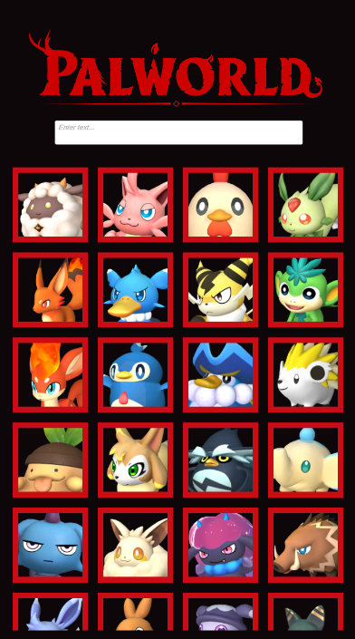
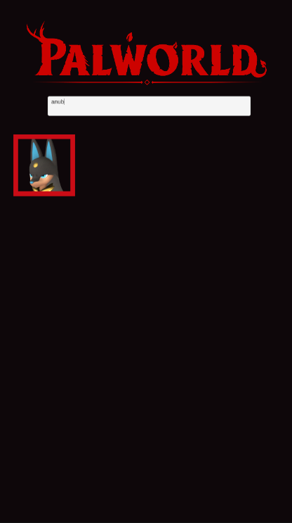
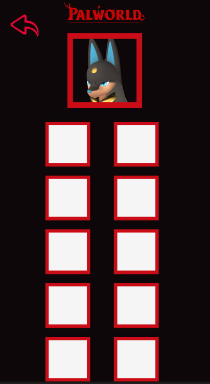

# Paldex


Este projeto Unity demonstra como criar uma interface de usuário (UI) interativa para explorar combinações de botões em uma grade. O projeto inclui a leitura de dados de um arquivo JSON, a representação desses dados em botões clicáveis e a exibição de combinações correspondentes em uma grade secundária.

## Funcionalidades Principais

- Leitura de dados a partir de um arquivo JSON.
- Exibição do botão clicado na parte superior da tela.
- Exibição dos botões correspondentes em uma grade na parte inferior da tela.
- Interface de usuário (UI) interativa e responsiva.

## Capturas de Tela
                           

## Requisitos do Sistema

- Unity 20XX.XX ou superior.
- Plataforma de desenvolvimento compatível (Windows, macOS, Linux).

## Instalação

1. Clone o repositório para o seu ambiente de desenvolvimento local:

```
git clone https://github.com/seu-usuario/unity-grid-button-combination.git
```

2. Abra o projeto Unity através do Unity Hub.

3. Navegue até a cena principal `MainScene` localizada no diretório `Assets/Scenes`.

4. Execute o projeto Unity no editor ou crie um build para a plataforma desejada.

## Uso

1. Execute o projeto Unity no editor ou inicie o build criado.

2. Clique em um botão na grade principal para visualizar as combinações correspondentes na grade inferior.

3. Observe como o botão clicado é exibido na parte superior da tela.

4. Experimente diferentes combinações de botões para explorar as funcionalidades do projeto.

## Estrutura do Projeto

- **Assets**: Contém todos os assets do projeto, incluindo scripts, prefabs, cenas e outros recursos.
  - **Scripts**: Scripts C# utilizados para controlar a lógica do projeto.
  - **Prefabs**: Prefabs reutilizáveis para botões e outros elementos da interface de usuário (UI).
  - **Scenes**: Cenas do Unity que compõem o fluxo principal do projeto.
- **Documentation**: Documentação adicional, incluindo este arquivo README.md.

## Contribuição

Contribuições são bem-vindas! Se você tiver alguma sugestão, correção de bugs ou desejar implementar novas funcionalidades, sinta-se à vontade para abrir uma issue ou enviar um pull request.

## Licença

Este projeto está licenciado sob a licença [MIT](https://opensource.org/licenses/MIT) - veja o arquivo [LICENSE](LICENSE) para mais detalhes.
